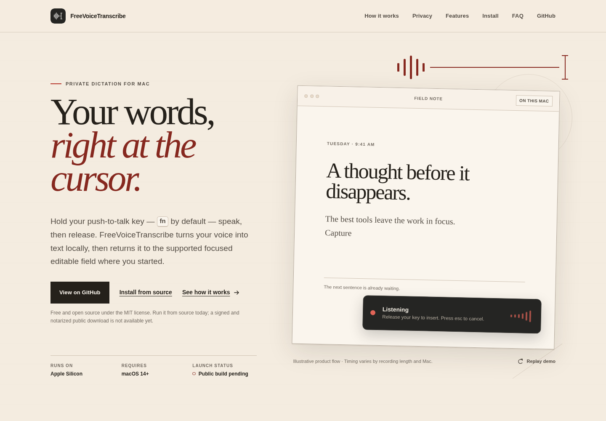

# FreeVoiceTranscribe

Private, local hold-to-talk dictation for Apple Silicon Macs. Focus an editable field, hold the push-to-talk hotkey (**fn/globe** by default), speak, and release to insert the transcript where you started.

FreeVoiceTranscribe is free, open-source software released under the [MIT license](./LICENSE).

**Website:** https://sdefendre.github.io/freevoicetranscribe/

> **Status:** there is no packaged download or GitHub release yet. A public build still needs Developer ID signing and Apple notarization. Run it from source with the steps below.



## What it does

- Hold the push-to-talk hotkey to record; release it to transcribe and insert. The default is **fn**. Change it in **Settings…** from the menu bar to Right Option, Right Command, Right Control, or F13. Right-side modifiers may not work on keyboards that do not distinguish left and right keys.
- Double-tap the hotkey to lock recording; tap it again to finish.
- Press **hotkey + Space** while recording to switch to hands-free mode; press the hotkey again to finish.
- Press **Esc** while recording to cancel and delete that recording.
- Recover the latest transcript with **Copy Last Transcript** or **Insert Last Transcript** from the menu bar.
- Choose **Transcribe audio file…** to pick or drop a wav, mp3, m4a, or similar file. There is no five-minute limit for files; long audio is transcribed in chunks with the selected Fast or Accurate model. Copy the result or save it as a `.txt` file. File transcription stays raw and does not use the writing model.
- Transcribe locally with a Fast or Accurate speech model through `lightning-whisper-mlx`. Accurate (`distil-large-v3`) is the default. Fast uses Whisper `small` for quicker on-device results.
- Optionally clean up **dictation** on this Mac with a small local writing model (off by default).
- Limit each hold-to-talk recording to five minutes.

### Dictation modes

Choose a mode from the menu bar. **Dictate** is the default and never uses the writing model.

| Mode | What it does |
| --- | --- |
| **Dictate** | Inserts the raw local transcript. |
| **Write** | Cleans filler words, punctuation, capitalization, and spoken self-corrections, then inserts the result. |
| **Command** | You select text first, then speak an instruction. The app rewrites that selection and pastes it back. |

Write and Command need a one-time on-device writing-model download (about 1 GB). Switching modes does not start that download; use **Download Model** in **Settings…**. If the model is missing, still loading, or fails, **Write** inserts the raw transcript and **Command** leaves the selection unchanged. Command also leaves the selection unchanged if it is empty or different at paste time.

You can also set an optional tone per app (for example Slack casual, Mail formal). The app looks at the frontmost app’s bundle ID and applies the prompt you saved in **Settings…**. Modes use whichever push-to-talk hotkey you chose.

FreeVoiceTranscribe has no account system, cloud transcription, transcript history, or always-on microphone. It is a menu-bar app after setup and does not remain in the Dock.

## Requirements

| Use | Requirements |
| --- | --- |
| Run from source | Apple Silicon Mac, macOS 14+, Python 3.11 to 3.13, PortAudio |
| Build the app | The same hardware and OS, plus a framework-capable arm64 Python 3.11 |
| First setup | Internet access and enough free space for the selected speech-model download |
| Optional Write / Command | The same Mac, plus about 1 GB more for the one-time writing-model download |

Install PortAudio with Homebrew:

```bash
brew install portaudio
```

Homebrew Python 3.11 is the recommended release-build interpreter. Static or standalone Python distributions are rejected because `py2app` cannot build a complete runtime from them.

## Supported languages

Both local models are multilingual. The app does not enforce a single language, so you can speak the supported languages in the same vocabulary without changing a setting. Choose **Fast** or **Accurate** in **Settings…** or the setup window. Accurate stays the default.

Commonly supported languages include:

- English
- Spanish
- French
- German
- Portuguese
- Italian
- Dutch
- Polish
- Russian
- Japanese
- Korean
- Chinese

For best results, use a natural pace and clearly separate sentences or phrases. Punctuation is optional for personal use.

### Speech models

| Option | Local model | When to use it |
| --- | --- | --- |
| **Accurate** (default) | `distil-large-v3` | Best quality. This is the original model. |
| **Fast** | Whisper `small` | Smaller download and quicker transcription. |

Open **Settings…** from the menu bar for both the push-to-talk hotkey and the speech model, or use the Fast / Accurate control in the setup window. The chosen model downloads on demand with a progress bar. Inference never leaves this Mac. Each model is stored separately, so switching later only downloads the one that is missing.

## Audio input device

FreeVoiceTranscribe records from your default input device. To use a specific microphone or USB audio interface, set it as the system default input before recording.

If you need better guidance for setup, use **Open Microphone Settings** from the setup window or the app menu bar when available.

## Quick start

```bash
brew install portaudio
git clone https://github.com/Sdefendre/freevoicetranscribe.git
cd freevoicetranscribe
./run.sh
```

## Run from source

The launcher creates `.venv` with the first compatible Python it finds, installs the pinned runtime requirements when `requirements.txt` changes, and starts the package entry point:

```bash
./run.sh
```

You can also create the environment manually:

```bash
python3.11 -m venv .venv
.venv/bin/python -m pip install -r requirements.txt
PYTHONPATH="$PWD" .venv/bin/python -m fvt
```

For a regular package install, the same direct dependencies are declared in `pyproject.toml`:

```bash
python3.11 -m venv .venv
.venv/bin/python -m pip install .
.venv/bin/freevoicetranscribe
```

`requirements.txt` pins direct source dependencies. `requirements.lock` contains the fully resolved runtime environment, while `requirements-build.lock` also includes build tooling. To reproduce the locked runtime:

```bash
.venv/bin/python -m pip install -c requirements.lock .
```

## First launch

The setup window guides you through three prerequisites:

1. **Microphone access**: captures only recordings you explicitly start.
2. **Accessibility access**: detects the global shortcut, verifies the focused editable field, and pastes the result.
3. **Speech model**: downloads the selected local model once. Accurate (`distil-large-v3`) is the default; Fast (Whisper `small`) is the quicker option. Switch later from **Settings…**.

Write and Command are optional. After setup, open **Writing Preferences…** and download the local writing model if you want cleaned-up text. That download also stays on this Mac.

After changing a permission in **System Settings → Privacy & Security**, return to FreeVoiceTranscribe and refresh setup. Packaged and source runs have different macOS permission identities, so switching between them may require granting access again.

### Compatible editable fields

Once setup is complete, focus an enabled editable field in another app before pressing the hold-to-talk hotkey. Apps with custom editors, web-based text fields without native Accessibility support, password fields, terminal shells without input permission, or remote desktop session controls may not expose a compatible target.

If you see **No editable text field is available**, try this before reporting a bug:

- Click directly inside a text field in a supported app.
- Stop screen-sharing or remote desktop sessions.
- Quit the input-consuming app and reopen the text field.
- Disable automation or scripting add-ons for the target app, then retry.

If the issue persists, use **Send Feedback** in the menu bar.

## Privacy and local data

- The microphone opens only while recording.
- Inference runs locally after the one-time download for the model you selected. A second speech model is downloaded only if you switch and it is not already on disk. The optional writing model is also local and never sends text to a server.
- Recordings are private 16 kHz mono temporary WAV files. They are deleted after transcription, error, or cancellation; crash leftovers are removed at the next launch.
- **Transcribe audio file…** reads the file you chose on this Mac. Temporary converted copies are deleted after transcription. The original file is not changed or uploaded.
- Exactly one transcript is persisted locally for recovery. A newer transcript replaces it; there is no history.
- Automatic insertion temporarily stages text on the clipboard. The previous clipboard is restored only if no other app changed it, so newer clipboard contents are preserved.
- The app captures the original process and exact focused editable Accessibility element. It verifies both again before insertion and fails closed rather than typing into another field.
- If verification or insertion fails, the transcript is copied to the clipboard. If copying also fails, it remains available from the menu bar.
- Rotating diagnostics contain event and error types, never transcript text.

Local files live outside the source tree and app bundle:

```text
~/Library/Application Support/FreeVoiceTranscribe/
├── device-settings.json    persisted device, shortcut, mode, and model preferences (mode 0600)
├── last-transcript.json    latest transcript only (mode 0600)
├── mlx_models/             downloaded speech models (`distil-large-v3`, `small`)
└── mlx_lm_models/          optional writing model, downloaded only from Settings

~/Library/Caches/FreeVoiceTranscribe/
├── Temporary/              temporary recordings
└── huggingface/            model-download cache

~/Library/Logs/FreeVoiceTranscribe/
├── app.log                 current diagnostic log
├── app.log.1               rotated log, when present
└── app.log.2               rotated log, when present
```

Application directories are created with private permissions when the filesystem permits it. `app.log` rotates at 512 KiB with two backups.

## Feedback and bug reports

Use **Send Feedback** in the menu bar. It opens a prefilled GitHub issue with your app version and a short bug report form. You can also open issues directly at https://github.com/Sdefendre/freevoicetranscribe/issues/new.

## Build the macOS app

The release script creates or refreshes `.build-venv` from `requirements-build.lock`, builds in a staging directory with `py2app`, signs the staged app, verifies it, and publishes only a passing artifact:

```bash
./build_app.sh
```

Successful output is written to:

```text
dist/FreeVoiceTranscribe.app
```

Use a specific compatible interpreter when needed:

```bash
PYTHON=/opt/homebrew/bin/python3.11 ./build_app.sh
```

The default is an ad-hoc signature for local testing. To exercise the hardened-runtime signing path with an installed Developer ID identity:

```bash
CODESIGN_IDENTITY="Developer ID Application: Your Name (TEAMID)" ./build_app.sh
```

To retain failed staging output for diagnosis instead of deleting it:

```bash
FVT_RETAIN_FAILED_STAGING=1 ./build_app.sh
```

The retained files appear under `build/failed-release/`, never `dist/`.

### Build gates

Before publishing to `dist/`, the build verifies:

- a bundled Python runtime with no copied virtual environment or external symlink;
- required Python and native modules, including MLX and Numba/OpenMP;
- arm64 native code with resolvable library dependencies;
- absence of model files from the signed bundle;
- nested and outer code signatures;
- a terminating isolated import smoke test; and
- normal app startup followed by menu-bar-loop liveness.

The smoke tests do not request Microphone or Accessibility access.

Developer ID signing alone is not a public release. Distribution still requires appropriate entitlements and hardened-runtime review, Apple notarization, stapling, Gatekeeper validation, and testing on a clean supported Mac.

## Development

Install the development tools into the source environment:

```bash
.venv/bin/python -m pip install -e '.[dev]'
```

Run the checks:

```bash
.venv/bin/python -m unittest discover -s tests -v
.venv/bin/python -m ruff check .
.venv/bin/python -m ruff format --check .
bash -n run.sh build_app.sh
```

Validate a candidate release-build interpreter separately:

```bash
/opt/homebrew/bin/python3.11 scripts/validate_build_python.py
```

Verify an existing bundle without rebuilding it:

```bash
.build-venv/bin/python scripts/verify_bundle.py \
  --launch-import-smoke \
  --launch-liveness-smoke \
  dist/FreeVoiceTranscribe.app
```

Use `--skip-signature` only for isolated verifier fixtures; it is not a release validation mode.

## Architecture

```text
fvt/app.py             application composition and lifecycle
fvt/state.py           legal states and immutable snapshots
fvt/audio.py           bounded capture and device-aware WAV handling
fvt/file_audio.py      local file decode, chunking, and transcript save
fvt/models.py          Fast / Accurate local-model catalog and downloads
fvt/transcription.py   local model readiness and PCM transcription
fvt/cleanup.py         optional on-device writing model for Write and Command
fvt/hotkey.py          resilient hold-to-talk, hotkey+Space, and Esc event tap
fvt/insertion.py       exact target validation and safe clipboard insertion
fvt/permissions.py     macOS permission checks and Settings recovery
fvt/storage.py         private paths, latest transcript, and rotating logs
fvt/ui.py              setup window, settings, menu bar, and multi-display HUD
scripts/               build interpreter, bundle, and launch verification
site/                  static landing page, published to GitHub Pages
```

The root `freevoicetranscribe.py`, `fn_listener.py`, and `overlay.py` files are compatibility shims for earlier imports and launch commands. New code should use the `fvt` package.

## Contributing

See `CONTRIBUTING.md` for build instructions, testing expectations, and pull-request guidance.

## License and distribution

This project is released under the MIT License. See `LICENSE` for the full terms.
